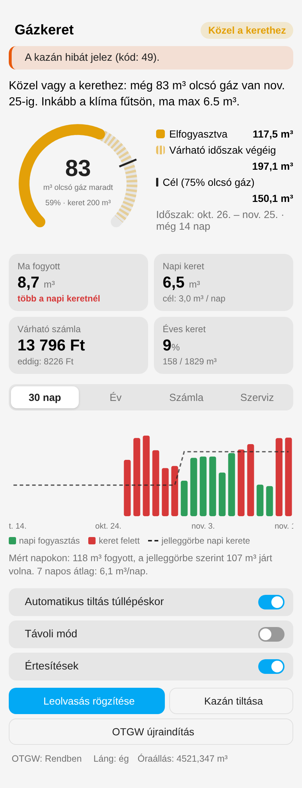
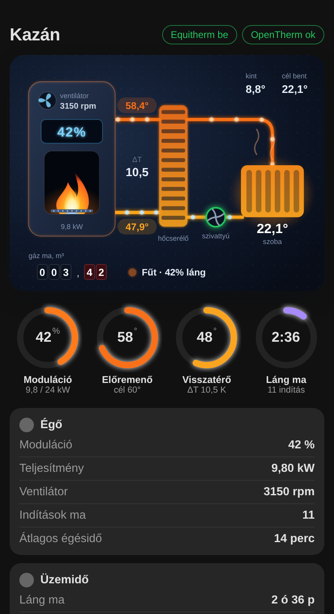

# MVM Gázkeret – Home Assistant integráció

Rezsicsökkentett gázkeret figyelése az **MVM 2024. augusztus 1-től érvényes, rögzített jelleggörbéje** alapján (63 645 MJ/év), OpenTherm gateway-jel vezérelt kazánhoz.

<p align="center">
  
  
</p>

## Mit tud?

- **Keret figyelése** havonta (leolvasástól leolvasásig), naptári hónapra és a kedvezményes évre (aug. 1 – júl. 31).
- **Napi keret:** mennyi gáz fogyhat még ma, és mennyi a javasolt mennyiség ahhoz, hogy az olcsó gáz ~75%-át elhasználd (a cél állítható).
- **Előrejelzés:** várható havi és éves fogyasztás, várható gázszámla (70 / 210 Ft/m³, állítható).
- **Havi leolvasás:** a beírt óraállás alapján korrigálja a reed jeladó mérését, és új elszámolási időszakot indít.
- **Értesítések:** közel a kerethez → túllépés várható → túllépve (időszakonként egyszer), plusz OTGW hiba, kazán hiba, tiltás.
- **Automatikus kazántiltás** túllépéskor (kapcsolható), feloldás új időszakkor vagy gombbal.
- **Távoli mód:** a beltéri célhőmérsékletet (Equitherm „Indoor temp”) leveszi pl. 16 °C-ra, visszakapcsoláskor visszaállítja.
- **OTGW felügyelet:** OpenTherm státusz + IP alapú elérhetőség-ellenőrzés; hiba esetén riaszt, és újraindítja a gateway-t (Restart gomb, vagy okos konnektorral áramtalanítás). Max. 3 próbálkozás / 6 óra.
- **Szerviz info:** kazán (fűtés) és égő üzemóra napi / havi / éves / összes, égőindítások száma.
- **Lovelace kártya** – automatikusan betöltődik, nem kell erőforrást felvenni.

## Telepítés (HACS)

1. HACS → jobb felső ⋮ → **Egyéni tárolók** → `https://github.com/gyarmati11/ha-gazkeret`, kategória: **Integráció**.
2. Telepítsd az „MVM Gázkeret”-et, majd indítsd újra a Home Assistantot.
3. Beállítások → Eszközök és szolgáltatások → **Integráció hozzáadása** → *MVM Gázkeret*.

HACS nélkül: másold a `custom_components/gazkeret` mappát a HA `config/custom_components/` mappájába, és indítsd újra.

## Beállítás – ajánlott értékek a te rendszeredhez

| Mező | Mit válassz |
|---|---|
| Gázóra jeladó | a reed szenzor összesítő m³ entitása |
| Szorzó | `1`, ha m³-t ad; ha impulzusszámot, akkor m³/impulzus (pl. `0.01`) |
| Fűtőérték | a gázszámládon szereplő MJ/m³ (alap: 34,8) |
| Kazán fűt | OTGW **Heating** |
| Láng | OTGW **Flame** |
| Hiba / hibakód | OTGW **Fault** / **Fault code** |
| Tiltó entitás | az OTGW **CH enable** kapcsolója (a letiltott entitások között lehet) – *kikapcsolom* |
| Távoli mód entitás | OTGW **Indoor temp** (number) |
| OTGW státusz | OTGW **Opentherm status** |
| Gateway IP / port | az ESP IP címe, `6053` |
| Újraindító gomb | OTGW **Restart** |
| Értesítés | pl. `notify.mobile_app_<telefon>` |

> Kombi kazánnál (nincs HMV tároló) **ne az egész kazánt tiltsd**, csak a fűtést (CH enable), különben meleg víz sem lesz.

## Lovelace kártya

```yaml
type: custom:gazkeret-card
entity: sensor.mvm_gazkeret_allapot
title: Gázkeret
```

A kártya a vizuális szerkesztőben is megtalálható „Gázkeret” néven.

## Kazán szervizkártya

Animált jelenet sötét műszerfal-stílusban: izzó csövek áramló részecskékkel (színük a valós hőmérsékletet követi), élő láng a moduláció szerint, forgó ventilátor, kijelző (moduláció vagy hibakód), szivattyú, izzó radiátor hőhullámokkal, gázóra-számláló a mai fogyasztással. Alatta körmutatók (moduláció, előremenő, visszatérő, mai lángidő), majd csoportosítva: Égő, Üzemidő, Szabályozás, Diagnosztika. Minden értékre koppintva megnyílik az entitás.

```yaml
type: custom:gazkeret-service-card
prefix: OpenTherm Gateway        # az OTGW eszköz neve – ez alapján találja meg az entitásokat
max_power: 24                    # a kazán névleges teljesítménye kW-ban
entities:                        # opcionális felülírások / kiegészítők
  room: sensor.nappali_homerseklet
  # pump: switch.keringeto
  # ch_enable: switch.opentherm_gateway_ch_enable
```

Automatikusan felismert kulcsok: `flow, ret, setpoint, modulation, flame, heating, dhw_active, fan, power, pressure, dhw_temp, fault, fault_code, diag_code, ot_status, outdoor, indoor, max_temp, min_temp, hysteresis, equitherm, pid, ch_enable, restart, reset_fault`.

## Szolgáltatások

```yaml
# Havi leolvasás (a kártyán gomb is van rá)
service: gazkeret.leolvasas
data:
  meroallas: 4521.347

# Aug. 1. óta már elfogyasztott gáz, ha a követés később indult
service: gazkeret.ev_eleji_fogyasztas
data:
  m3: 85
```

## Hogyan számol?

- Minden napra a hónap kedvezményes mennyiségének napi része jut (MVM rögzített megosztás), MJ-ban, a fűtőértékkel m³-re váltva.
- Elszámolási időszak: utolsó leolvasástól egy hónapig. Leolvasás nélkül naptári hónap.
- Várható fogyasztás: 7 napos átlag, a jelleggörbe alakjával skálázva a hátralévő napokra.
- Éves előrejelzés: a hátralévő éves keret × az elmúlt 30 nap tényleges/keret aránya.
- Az MVM az év végi (júl. 31-et tartalmazó) elszámolásban a hónapok közti különbséget beszámítja, így egy-egy havi túllépés évesen kiegyenlítődhet.

Az árak és a keret a beállításokban módosíthatók, ha változnának.
